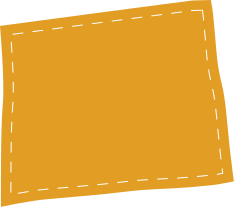
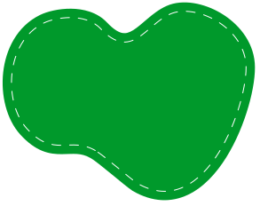
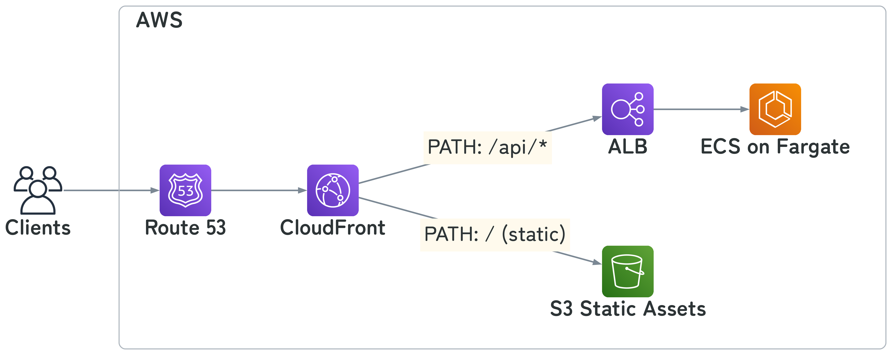
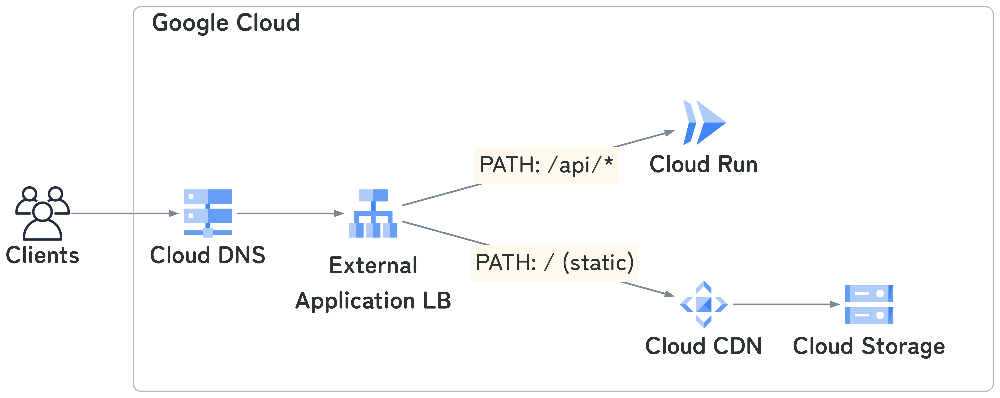
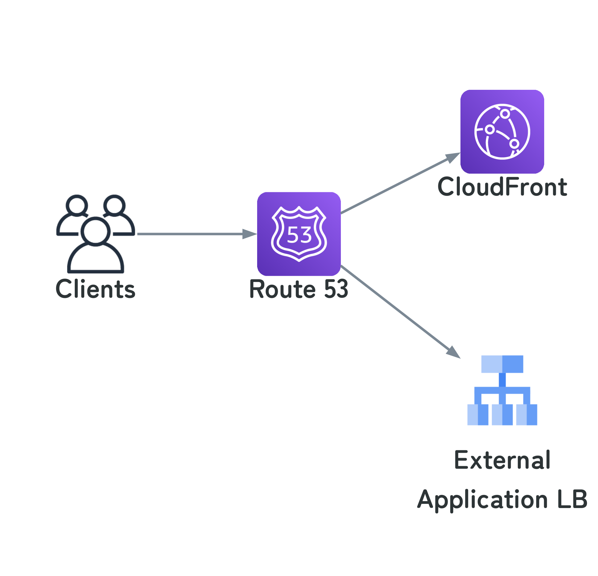
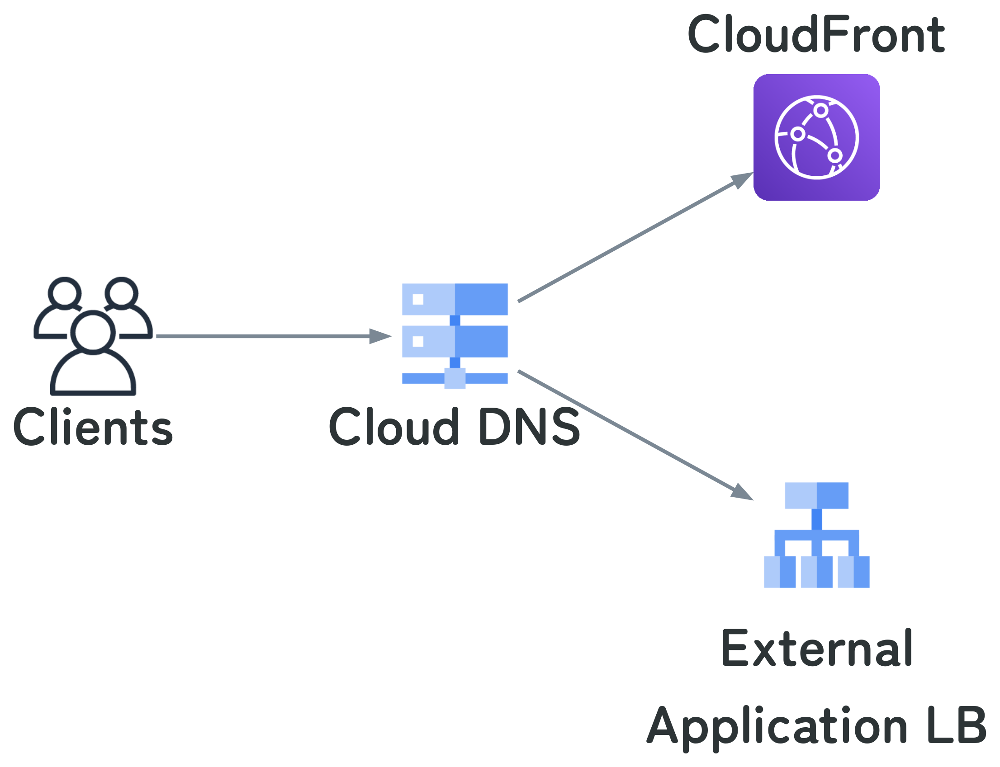
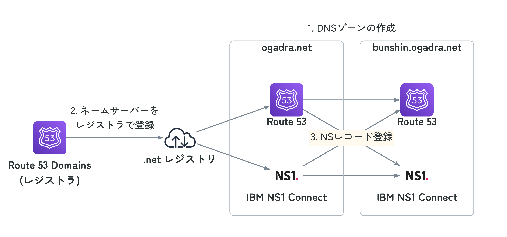
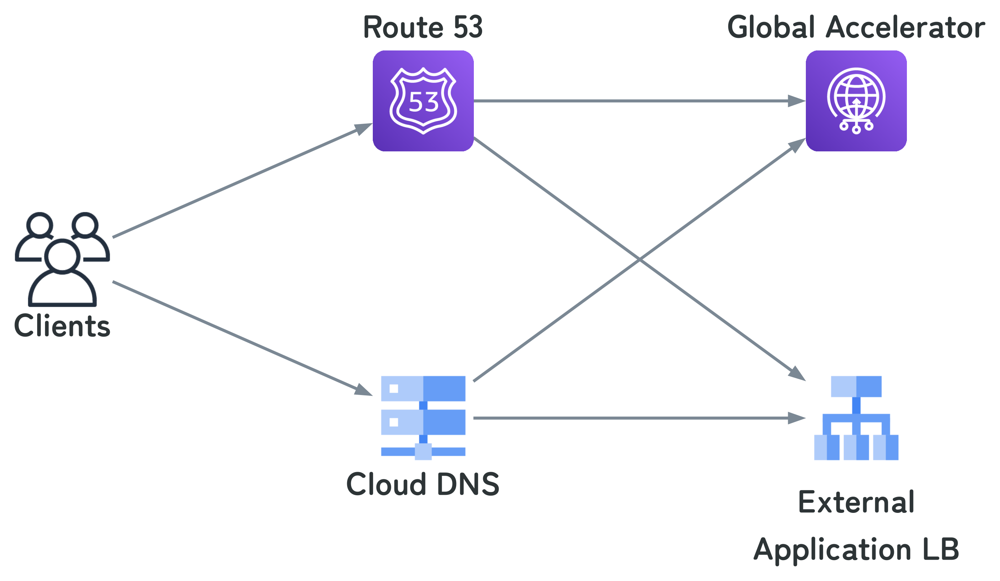
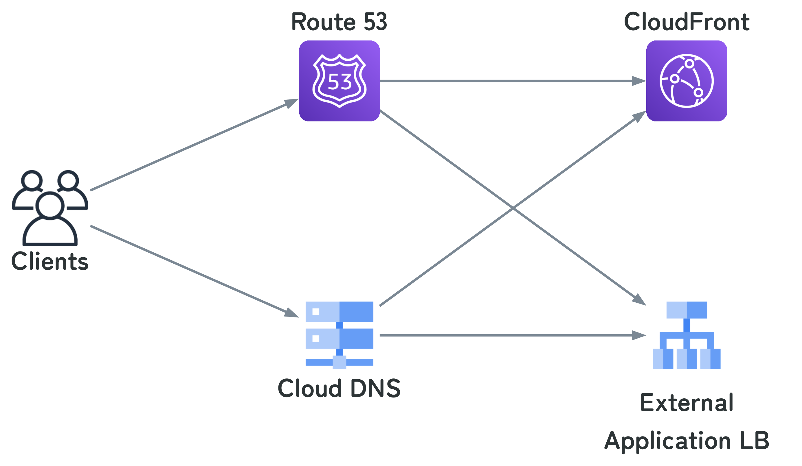

# それでも、 DNSを冗長化したい

## ogadra

---
class: text-center-body
---

## なぜDNSを冗長化するのか

カンファレンス登壇なので、**絶対に**失敗したくない

特定のクラウドプロバイダの**全サービス**がサービスダウンしても

サービス継続できるだけの可用性が欲しかった

---

## 前提となった技術要件

大吉祥寺.pmの登壇に用いたデモアプリ

AWSおよびGoogle Cloudのマルチクラウド構成

いずれかのクラウドが落ちてもサービスが提供できること

---
clicks: 2
---

## 前提となった技術要件

AWSが落ちたら 
Google Cloudに接続する

<FailoverFigure :step="$clicks" fail="server" />

---
clicks: 2
---

## 実現したいシステム

Route53が落ちたら 
Cloud DNSで名前解決する

<FailoverFigure :step="$clicks" fail="dns" />

---

## AWSを利用した一般的なサービス構成

---

## Google Cloudを利用した一般的なサービス構成

---

## なぜDNSを冗長化することが難しかったのか

権威DNS間のレコード同期には基本的に 
**ゾーン転送** (IXFR / AXFR)を用いる

1. Route 53やGoogle Cloud DNSはゾーン転送に非対応
2. ゾーン転送ではヘルスチェック等を同期できない

それぞれのDNSに同じレコードを登録すればいいのでは？

---

## なぜDNSを冗長化することが難しかったのか

それぞれのDNSに同じレコードを登録した場合

Cloud DNS  CloudFrontの**ヘルスチェックができず**

当初の要件を満たすことができなかった

---

## なぜDNSを冗長化することが難しかったのか

Amazon CloudFrontは 
通常、FQDNしか払い出さない

標準的なDNSレコードでは、 
CNAMEレコードを使用する

---

## CNAMEレコードとは

CNAMEレコードは 
**このドメイン名は** 
**別のドメインの別名である** 
ということを伝えるレコード

問い合わせのあった 
レコードを別のレコードに 
読み替え、名前解決をする

<CnameFigure />

---

## なぜDNSを冗長化することが難しいのか

CNAMEレコードは 
同じ名前に対する 
A / AAAAレコードなどと 
**同居できない** (RFC&nbsp;2181)

<CnameConflictFigure />

---

## Aliasレコードについて

Route 53の機能

CNAMEの代わりに、 宛先のIPアドレスを A / AAAAレコードとして返す仕組み

宛先はAWSの一部リソース等に限られる

<AliasFigure />

---

## Aliasレコードについて

Cloud DNSでは**ALIASレコード**、 
Cloudflareでは**CNAME flattening**という名称で提供

各社微妙に仕様が異なる

---

## なぜDNSを冗長化することが難しいのか

External Application LBは通常のA / AAAAレコードを、 
CloudFrontは**Alias Record**を使って 
DNSレコードを登録

---

## なぜDNSを冗長化することが難しいのか

Cloud DNSでは CNAME / ALIASに 
ヘルスチェックを設定できない

Cloud DNSを含めた構成だと 
可用性を十分に確保できない

---

## なぜDNSを冗長化することが難しいのか

Route 53 + Cloud DNSが今回の要件に合わない

1. Cloud DNSではFQDNに ヘルスチェックを 設定できない
2. AXFR / IXFRによるゾーン情報の同期が不可

---

## サービス選定に立ち戻る

- FQDNとIPアドレスの両方を扱えること
- ヘルスチェックによって応答を切り替えられること
- ゾーン転送、DNSSECは諦める

**IBM NS1 Connect**を採用

---

## 登録する

---

## 1. DNSゾーンの作成 (Route 53)

### DNSゾーンとは

特定のドメインのDNSレコードを管理する単位

マネージドサービスで 
ゾーンを作成すると、 
ネームサーバーが割り振られる

<HostedZoneFigure :step="1" />

---

## 1. DNSゾーンの作成 (Route 53)

### DNSゾーンとは

割り振られたサーバーを 
親ゾーンにNS設定すると、 
インターネットから 
名前解決できるようになる

<HostedZoneFigure :step="2" />

---

## 1. DNSゾーンの作成 (Route 53)

- 管理・委任する単位ごとに作成
  - 各プロバイダ
  - 各(サブ)ドメイン

<DelegationFigure :step="1" />

---

## 2. ネームサーバーをレジストラで登録

- レジストラで それぞれのNSを登録
- ゾーンのレコードも 更新
  - ゾーンApexの NSレコード

<DelegationFigure :step="2" />

---

## 3. NSレコード登録

- 子ゾーンのNSレコードを親ゾーンに登録
  - 各DNSゾーンのNSレコード
- 子ゾーンのNSレコードを各ゾーンで共通の値に

<DelegationFigure :step="3" />

---
clicks: 1
---

## 出来上がったもの

= 1 }]">

---

ね、簡単でしょ？

---

やり方は一つじゃない - TMTOWTDI

---

## Global Accelerator を使えばAレコードになる

---

## CloudFrontのAnycast static IPsを申請する

---

## まとめ

DNSサービスの仕様は各社で異なるため、 それぞれの布片を1枚の布に仕立てるのは大変

ばらばらなDNSサービスを、 NSレコードという糸で縫い合わせ、 どこかが欠けてもほつれない布に仕立てられた

---

## Thank you for listening!

Done is better than perfect.

- Twitter: [@const_myself](https://twitter.com/const_myself)
- GitHub: [ogadra](https://github.com/ogadra)

<PoweredBySlidev mt-10 />

