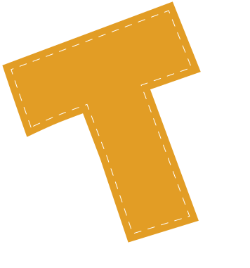
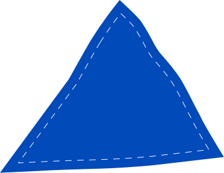

# それでも、 DNSを冗長化したい

## ogadra

---

## 前提となった技術要件

---

## なぜDNSを多重化するのか

---

## AWSやGoogle Cloudを利用した一般的なサービス構成

---

## なぜDNSを多重化することが難しいのか

---

## CNAMEとAレコードを同時に登録する手法、ALIASレコードについて

---

## CloudFrontの制約とCloud DNSの制約の噛みあわないところ

---

## delegation(委任)とは

---

## 各サービス比較

---

## 構成例

---

## 出来上がったもの

---
layout: image-x
image: https://media.ogadra.com/misskey/drive/b7f08bb1-df92-45c3-855d-521eb9859015.gif
imageOrder: 2
---

## Thank you for listening!

Done is better than perfect.

- Twitter: [@const_myself](https://twitter.com/const_myself)
- GitHub: [ogadra](https://github.com/ogadra)

<PoweredBySlidev mt-10 />

